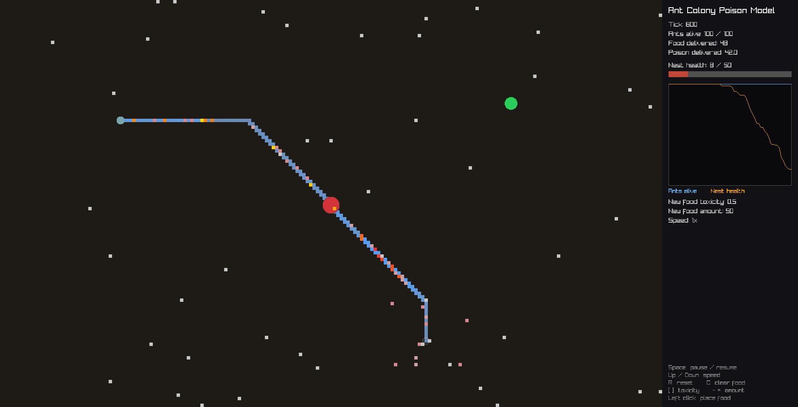

# Ant Colony Poison Model

An agent-based simulation of an ant colony foraging on poisoned food, written in C++17 with raylib. Ants search for food, lay pheromone trails, and carry food back to the nest. Toxic food hurts the ants carrying it and poisons the colony once it's delivered.



## Research question

What amount and toxicity of poisoned food exterminates a colony fastest, while still letting ants survive long enough to carry the poison home? If the dose is too weak, the colony survives. If it's too strong, ants die on the way back and the poison never reaches the nest.

The full model specification, written before any code, is in [docs/model-spec.pdf](docs/model-spec.pdf).

## How the model works

The world is a 195 × 120 grid with a nest in the center, 100 ants, food sources placed by the user, and a pheromone layer.

Each tick runs in this order:

1. Pheromone on every cell decays by 1%.
2. Every ant takes its turn.
3. The nest takes in any food delivered that tick.

**Ants** are in one of two states:

- **Searching:** the ant only senses its own cell and the four cells next to it. If one has food, it takes it. Otherwise, if a neighbor has pheromone, it may follow the trail, and stronger trails are more likely to be joined. Otherwise it wanders randomly.
- **Returning:** the ant walks straight home, dropping pheromone on every cell it crosses. This is what builds the trails.

**Poison** hurts an ant when it picks up toxic food and keeps hurting it while it carries the food. Ants slow down as their health drops and die at zero. An ant that dies on the way home loses its food, so that poison never reaches the nest.

**The nest** has a poison tolerance that scales with colony size (100 ants × 0.5 = 50). Each delivery lowers it by the food's toxicity. The run ends when the nest's tolerance reaches zero (colony poisoned) or every ant is dead.

## Design notes

- **Following trails outward.** Returning ants lay the freshest pheromone near the nest, because the food end of a trail has had longer to decay. An ant that always stepped to the strongest neighbor would walk home instead of to food, so searching ants only follow trail cells that lead away from the nest.
- **Joining a trail vs. staying on it.** The chance to follow pheromone is rolled only when an ant first steps onto a trail. Rolling on every step made the odds multiply, and ants fell off after a cell or two.
- **Speed on a grid.** Poisoned ants slow down, but they can only move whole cells. Each ant banks its speed every tick and steps once it has built up a full cell's worth, so an ant at half speed steps every other tick.
- **Model speed separate from frame rate.** The model runs a set number of ticks per second (15 at 1×) using the same banking idea with time, while the window draws at 60 FPS.
- **Simulation and drawing are separate.** `Simulation` knows nothing about graphics, and `Renderer` only reads from it, so the model could run without a window.
- **Reproducible runs.** All randomness comes from one seeded generator. Setting `seed` in `Config.h` repeats a run exactly.

## Controls

| Input | Action |
|---|---|
| Left click | Place food |
| Space | Pause or resume (the run starts paused) |
| Up / Down | Double or halve speed (1× to 64×) |
| `[` / `]` | Lower or raise toxicity of new food (0 to 1) |
| `-` / `=` | Lower or raise amount of new food |
| R | Reset the run, keeping placed food |
| C | Clear all food |
| Esc | Quit |

Food color shows toxicity, from green (harmless) to purple (fully toxic). Ants are gray while searching and yellow while carrying food, and turn red as they're poisoned. The nest turns from brown to red as poison builds up.

## Building

You'll need a C++17 compiler, CMake 3.16 or newer, and [raylib](https://github.com/raysan5/raylib) 5.x installed where CMake can find it.

```bash
git clone https://github.com/markanthony5500/AntAgentModel.git
cd AntAgentModel
cmake -S . -B build -DCMAKE_BUILD_TYPE=Release
cmake --build build
./build/ant_sim
```

Built and tested on Ubuntu 24.04. The window is 1880 × 960. For a smaller screen, lower `gridWidth`, `gridHeight` or `cellSize` in `src/Config.h`.

## Configuration

All parameters are in [src/Config.h](src/Config.h). The main ones:

| Parameter | Default | What it does |
|---|---|---|
| `antCount` | 100 | Starting number of ants |
| `foodAmount` | 50 | Units of food in each new source |
| `foodToxicity` | 0.5 | Toxicity of new food, from 0 to 1 |
| `ingestDamage` | 20 | Health an ant loses picking up food, times toxicity |
| `carryDamagePerTick` | 0.2 | Health lost per tick while carrying, times toxicity |
| `pheromoneDecayRate` | 0.01 | Fraction of pheromone lost per tick |
| `nestTolerancePerAnt` | 0.5 | Nest poison tolerance per ant |
| `ticksPerSecond` | 15 | Model speed at 1× |
| `seed` | 0 | 0 for a random run, any other value to repeat a run |

## Project structure

```
src/
  main.cpp        Window, main loop, and controls
  Config.h        All model and display parameters
  Simulation.*    Owns the model and runs each tick
  Ant.*           Ant behavior: searching, trail following, returning, poison
  Grid.*          Pheromone layer
  Nest.*          Colony health and delivery stats
  FoodSource.h    Food amount and toxicity
  Renderer.*      Drawing and the stats panel
docs/
  model-spec.pdf  Model specification
  screenshots/
```

## Future work

- Export each run's population and nest health to CSV, to compare low, medium and high toxicity across many runs (spec section 12.6).
- Ants with different poison resistance (spec section 3.1).
